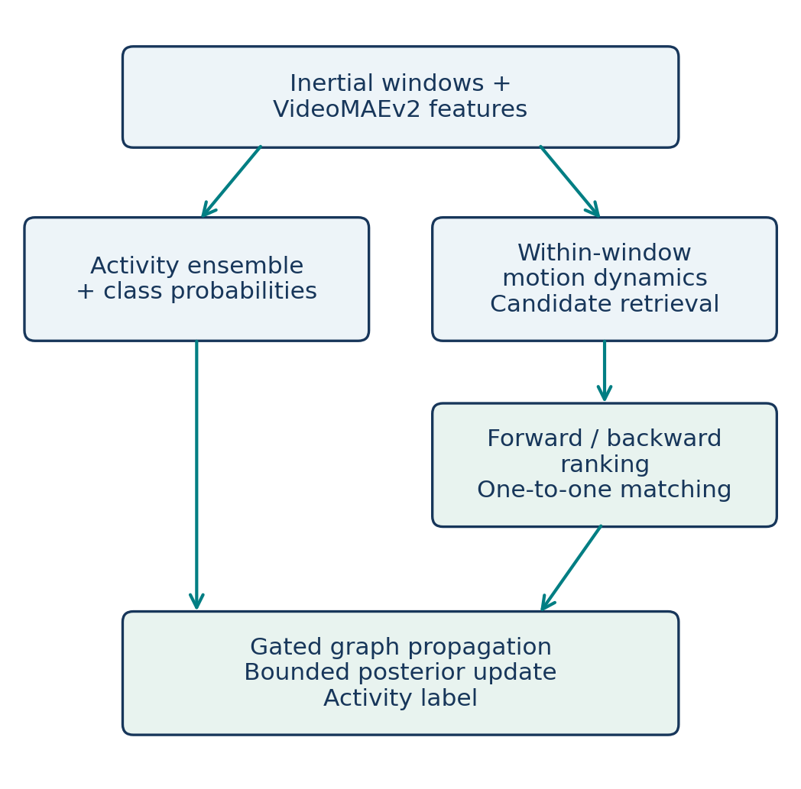

# Bidirectional window matching on WEAR

Gaurav Vyas's solution to the [3rd WEAR Dataset Challenge at HASCA 2026](https://www.kaggle.com/competitions/3rd-wear-dataset-challenge-hasca-2026), with an entrant-reported **rank of 3 on the final Kaggle private leaderboard**.

- [Technical report](report/main.pdf) · [ACM LaTeX source](report/main.tex)
- [Submitted predictions](results/final_submission.csv) · [Benchmark results](results/scores.csv)
- [Competition data](https://www.kaggle.com/competitions/3rd-wear-dataset-challenge-hasca-2026/data) · [Organizer guidelines](https://mariusbock.github.io/wear/challenge.html)

A multimodal ensemble produces activity posteriors from acceleration and egocentric VideoMAEv2 features. Participant-specific candidate edges are scored independently in the two temporal directions, matched one-to-one, and combined with same-bout and same-label edges. A bounded graph update refines the parent ensemble's scores.

| Result | Macro-F1 |
|---|---:|
| Parent ensemble, public | 0.93611 |
| Submitted solution, public | **0.93821** |
| Bidirectional graph, participant-grouped source benchmark | 0.93130 |

The source result is a paired graph-development benchmark. Final private macro-F1 remains unverified. The 12,234 prediction rows correspond to Kaggle submission 57113473. SHA-256: cd09abd1902253864b33abe72b552c932eb7c65d2246c04955ddc1598edb3e7f.

## Data and reproduction

The repository contains derived benchmark results and the exact submitted predictions. Obtain the original inertial and video features from the competition's Data tab. The raw recordings and trained checkpoints are required to rerun training and are distributed separately from this repository.

Run 'python scripts/make_figures.py --inertial PATH_TO/test_inertial_data.npy' with NumPy and Matplotlib to reproduce the report figures. From 'report/', run 'latexmk -pdf main.tex' with ACM acmart installed. The supplied PDF is a separately rendered review copy.

## AI assistance

AI tools assisted with drafting the report and with developing and refining the solution.
